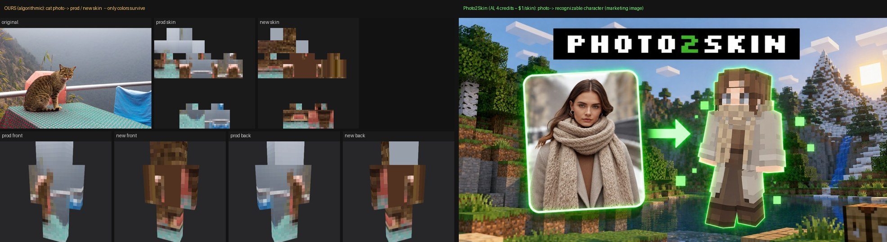

# image2minecraftskin：要不要做 AI 生成？竞品与付费意愿调研（2026-10-18）

> 只做了调研，没有改代码，也没有花钱生成图片。所有价格都抄自竞品公开的定价页（2026-10-18 抓取）。流量数字来自公开的第三方估算，只能看个大概。
> 样图在 `samples/` 目录，大多是竞品官网上的营销图。竞品展示的都是挑过的好结果，实际效果会比这差一些。

## 一句话结论
**值得做 AI，但这是个小生意，别指望它变成主要收入。** 先用现在的"假门"候补名单验证 2 到 4 周，数据过线再开发。
- 头部竞品已经全面转向 AI。只做"照片像素化"的基本都是免费小工具，没有一家在收费。
- 有人付费，但市场不大。一位独立开发者公开说，他的 AI 皮肤生成器上线 4 个月，平均每月收入约 **$100**。
- 技术上我们有一个优势：AI 画出一张干净的正面/背面角色图，再交给我们现有的算法转成 64×64 皮肤。AI 部分每张成本大约 **$0.04 到 $0.08**。

## 一、效果对比（最直观）

- 左边是我们：猫的照片转成皮肤，只有颜色对，看不出是猫。新版比线上好，但上限就是"取色"。
- 右边是 Photo2Skin（AI）：真人照片生成的角色，围巾、大衣、发色都能认出来。
- 原因：64×64 的皮肤里，脸只有 8×8 个像素。直接把照片压缩进去，细节一定会丢光。AI 的做法是先"重新画一个 Minecraft 风格的角色"，再贴到皮肤上，所以看着像。

## 二、竞品一览（13 家，含我们）

| # | 竞品 | 做法 | 输入 | 价格 | 免费额度 | 单张皮肤价格 | 付费迹象 |
|---|---|---|---|---|---|---|---|
| 1 | **Photo2Skin** (photo2skin.com + iOS) | AI | 照片/图片/文字/Roblox | **只能订阅**：$12.99/月 48 积分，$39.99/年 576 积分；加购包 $2.99/12 积分，仅限订阅用户 | Web 版要用 Google 登录，免费功能只有编辑器、皮肤库和抓取 | 4 积分一张，月付约 **$1.08**，年付约 $0.28 | 定价页完整；iOS 评分 3.3（10 个评分），差评说"要收钱/骗钱"；X 上在主动推广 |
| 2 | **SkinMaker** (skinmaker.app) | AI，页面写明通过 **KIE** 调用 Nano Banana 2 和 GPT Image 2 | 照片/角色图 + 文字 | 一次性包 $9/9 张、$39/45 张；订阅 $29 到 $99/月 | 免费的只有打包工具 | 约 **$0.87 到 $1** | 定位是"帮卖皮肤的画师交付"，B2B，价格高 |
| 3 | **Photo to Skin**（AIWizard 收录） | AI 两步走：图像模型先画正面和背面，再转成 64×64 | 照片（Beta）/文字 | $8/月 50 积分，$19/月 200 积分；一次性 $5/20、$15/100 | 送 1 积分，只够文字生成一次 | 照片 3 积分，约 **$0.29 到 $0.75** | 定价完整；照片模式要等几分钟 |
| 4 | **ImagineGo** AI Minecraft Skin | AI 两步走（流程同上） | 照片/文字 | 照片 15 积分、文字 3 积分，积分是全站通用的 | 未公开 | — | 只是综合 AI 工具站里的一个功能 |
| 5 | **SkinGenerator.io** | AI（自己微调的 Stable Diffusion） | **只支持文字** | $2.49/50、$4.99/125、$9.99/333 | 5 次 | **$0.03 到 $0.05** | 流量约 **7.2 万访问/月**（HypeStat/Toolify 估算），老牌，2024 年起就在 Reddit 推广 |
| 6 | **MCSkin.app** | AI（自研模型 "SkinCraft v1.1"） | 文字 | $2.49/50、$4.99/120、$9.99/300，有效期 1 年 | 注册送 1 次 | $0.03 到 $0.05 | 付费后作品可以设为私有，用这个做卖点 |
| 7 | **MinecraftSkin.app** | AI | 文字，一个想法出 4 张 | $2.99/60、$4.99/200、$9.99/500，**不做订阅** | **4 张免费，不用注册**；看激励广告可再拿 2 张，每天最多 3 次 | **$0.02 到 $0.05** | 专门写了"家长须知"：二次确认、提醒未成年人先问家长 |
| 8 | **BlockSkin Studio** | AI（渲染和"风格化"为主） | 参考图/皮肤 | $1.99 到 $14.99 一次性；能直接用的皮肤要 $9.99 档 | — | — | 号称 50 万用户，是营销数字，无法核实 |
| 9 | **MCSkinTools** | AI（页面写着"AI 先简化角色，再映射成皮肤"） | 图片 | 免费，要登录 | 免费 | 0 | 是一个工具合集站，用来拉流量 |
| 10 | **MakeSkins** | 很可能是算法（自动框出人脸、裁剪），没看到 AI 的说法 | 自拍 | 免费，不用注册 | 无限 | 0 | 没有收费 |
| 11 | **BlockSkinLab** | **算法**，在浏览器本地处理 | 任意图 | 免费 | 无限 | 0 | 没有收费；提供"一键加五官"来弥补脸部 |
| 12 | **tgb Image To Skin** | **算法**，开源 | 任意图 | 免费 | 无限 | 0 | 没有收费 |
| 13 | **我们 image2minecraftskin** | 算法，本地处理 | 任意图 | 免费 | 无限 | 0 | AI 候补名单（假门）这次刚上线 |

**规律**
1. **照片转皮肤**这条赛道，收费的全是 AI 产品，每张大约 **$0.3 到 $1**。只做算法的全是免费工具。
2. **文字生成皮肤**已经打成价格战，每张 **$0.02 到 $0.05**，普遍给 4 到 5 张免费，还有不用注册的。
3. 主流做法是**两步走**：图像模型先画出 Minecraft 风格角色的正面和背面，再用程序把它铺到 64×64 的皮肤模板上。我们现有的算法正好可以做第二步，而且干净的角色图正是它最擅长的输入（见 BlockSkinLab 的角色图样例，`samples/blockskinlab_character-*.png`）。

## 三、用户口碑和付费意愿
- **想要的人确实有**：r/Minecraft 2025-06 有人发帖"为什么没有 AI 能用自拍生成像我的皮肤"，17 条评论。但也有人反驳"就那么几个像素，像不了"。
- **核心玩家社区反感 AI**：r/minecraftskins 从 **2026-08-31 起全面禁止 AI 内容**，包括 AI 皮肤、渲染图和推广 AI 服务。所以别指望在 Reddit 皮肤社区推广，流量还得靠 SEO。
- **付费规模小**：X 上 2026-10-15 有独立开发者说，他的"能直接进游戏的"AI 皮肤生成器上线 4 个月，平均每月约 **$100**。
- **订阅制容易招差评**：Photo2Skin 的 iOS 差评集中在"标着免费却要付钱"和"只想要钱"。用户很多是小孩，订阅加付费墙口碑差。MinecraftSkin.app 刻意做成"只卖一次性包，并提醒家长"。
- **移动端更大**：老牌编辑器 Skinseed（iOS）据 AppGoblin/AppRank 估算每月收入 $7K 到 $10K+，靠的是多年攒下的用户和订阅，不是只靠 AI。
- X 上的 Minecraft 皮肤画师提到，TikTok 上有人在推 AI 皮肤 App，说明这个品类在 C 端有人买，也说明画师群体有抵触。

## 四、建议

### 1. 要不要做 AI？
**要做，但做成付费的增值功能。免费的算法工具继续保留，作为默认选项。**
- 免费算法版是我们的流量来源，也是"图片不上传、隐私安全"这个卖点所在，不能去掉。
- 算法出结果后，在结果旁边放一个"AI 版本：让它真的像你/你的猫"的按钮。用户刚看到"不太像"的结果，这时候最愿意升级。

### 2. 技术路线和成本（只按公开 API 价格估算）
- 方案：**图像编辑模型生成"正面+背面"角色设定图（1K 分辨率），再用我们现有的算法转成 64×64 皮肤**。和 Photo to Skin、ImagineGo 的做法一样。
- 每次调用价格：
  - KIE 上的 Nano Banana 2：1K 约 **$0.04**/张（2K 约 $0.06）
  - fal 上的 Nano Banana 2 edit：1K 约 $0.08/张
  - GPT Image 2 edit（fal）：1024 尺寸低质量 $0.015，中等 $0.061，高质量 $0.219
- 估算每个皮肤成本：生成 1 次加平均 0.5 次失败重试，约 **$0.06 到 $0.12**。如果默认一次出 2 个候选，成本翻倍。
- 我们其他站（coloringeasy、imgenhance）已经在用 KIE，账号和积分系统可以直接用。

### 3. 定价假设
- **免费**：登录后送 1 次 AI 生成（成本约 $0.1），作为获客成本。
- **一次性包，不做订阅**：$2.99 买 15 次（每次 $0.20），$6.99 买 50 次（每次 $0.14）。比 Photo2Skin 的每张 $1 便宜很多，又比文字生成的价格战高，因为照片转皮肤更难做，可以定高一点。
- 毛利：每次收入 $0.14 到 $0.20，成本约 $0.06 到 $0.12。注意支付手续费（Stripe 每笔约 $0.30 + 2.9%），所以不要卖低于 $2.99 的包。
- 失败自动退积分（竞品都这么做），购买前提醒未成年人先问家长。

### 4. 怎么低成本验证（不花生成费）
现有的假门候补名单够用了。需要做的是把以下埋点数据看起来，跑 **2 到 4 周**，或者等到至少 500 次算法转换：

| 指标 | 定义 | 过线（建议） | 不过线 |
|---|---|---|---|
| AI 入口点击率 | 点 AI 按钮的人数 / 完成算法转换的人数 | ≥ 5% | < 2% |
| 留邮箱率 | 提交邮箱的人数 / 点 AI 按钮的人数 | ≥ 25% | < 10% |
| 每周绝对量 | 每周留邮箱的人数 | ≥ 20 | < 5 |
| 价格接受度（可选） | 在假门上写明"$2.99 起"，对比加价格前后的留邮箱率 | 下降 < 50% | 下降 > 70% |

- 全部过线：开发 MVP，先接 KIE Nano Banana 2，给候补名单发邮件，每人送 1 次免费额度。
- 只有点击率高、留邮箱率低：说明想要但不想留邮箱，可以考虑不登录先送 1 次。
- 点击率很低：不做，继续靠免费工具和 SEO 吃流量。
- 想更快看到真实付费意愿：可以选几十个候补用户，人工帮他们生成并报价（属于"人工代做"测试）。这一步要花少量生成费，需要你同意。

## 五、风险
1. **市场小**：独立开发者的公开数据是每月约 $100。即使做好了，预期也只是每月几十到几百美元的补充收入。
2. **用户多是未成年人**：涉及支付纠纷、退款和儿童隐私。只卖一次性包，加家长提醒。
3. **和隐私卖点冲突**：AI 版要把照片发给第三方模型。必须用户主动勾选同意，免费版继续本地处理。
4. **效果不稳定**：AI 偶尔会画错部位（比如有 Reddit 用户反馈眼镜位置画错），所以要有失败退积分和"重画一次"。
5. **社区抵触**：Reddit 的皮肤社区禁止 AI 内容，推广只能靠 SEO，没法做社区营销。
6. **价格战**：文字生成已经卷到每张 $0.02，照片转皮肤以后也可能降价。

## 来源
- 定价页：app.photo2skin.com/pricing、skinmaker.app/pricing、skingenerator.io、mcskin.app/pricing、minecraftskin.app/pricing、blockskinstudio.com/pricing、imaginego.ai/ai-tools/ai-minecraft-skin-generator、aiwizard.ai/photo-to-skin
- 做法说明：skinmaker.app/workbench（写明 Kie.ai、Nano Banana 2、GPT Image 2）、bestfor.ai（SkinGenerator 微调 SD）、mcskintools.com、blockskinlab.com
- 流量：HypeStat 和 Toolify 对 skingenerator.io 的估算（约 7.2 万/月）；AppGoblin 和 AppRank 对 Skinseed 的估算
- 口碑：r/minecraftskins 公告"AI-Generated content will no longer be allowed"（2026-08-31）；r/Minecraft 帖子 1l2dybi（2025-06）；X @Mr_CadenG 2026-10-15 的回复（$100/月）；Photo2Skin App Store 评价
- API 价格：kie.ai/nano-banana-2、fal.ai 上的 nano-banana-2/edit 和 gpt-image-2/edit 页面
- 本地原始 HTML：`/workspace/i2m-ai-research/html/`（没有提交到仓库）
